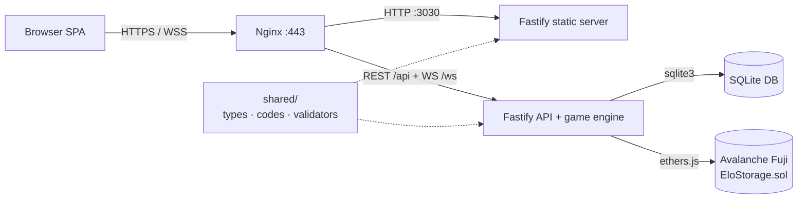

# ft_transcendence — Multiplayer Pong Platform

Built by **lguerbig**, **tle-floc**, **pchalmin**, **ael-atmi** and **tilegran** as a 42 school group project.

A full-stack, real-time Pong platform built in a team of five as the final project of the 42 Common Core. Players can sign up, climb a seasonal leaderboard, challenge an AI or a remote opponent, and customize the game — all served over HTTPS/WSS from a three-container Docker stack.

> [!CAUTION]
> This repository implements **version 18** of the 42 `ft_transcendence` subject, which is not the latest version available today. The original subject is included in [`ft_transcendance_v18.pdf`](./ft_transcendance_v18.pdf).

## Table of contents

- [Overview](#overview)
- [Features](#features)
- [Engineering highlights](#engineering-highlights)
- [Technologies used](#technologies-used)
- [Project architecture](#project-architecture)
- [Compiling and running the project](#compiling-and-running-the-project)
- [Subject modules covered](#subject-modules-covered)
- [Quality checks](#quality-checks)
- [Documentation and deeper dives](#documentation-and-deeper-dives)
- [Team](#team)
- [Sources](#sources)

## Overview

The goal of the project was to build a complete web application from scratch while learning unfamiliar technologies: a single-page application in TypeScript, a Fastify API, a server-authoritative 3D game, and a smart contract that stores ranked results on a blockchain.

The result is a SPA (Simple Page Appllication) where users can:
- create an account (or enter as a guest), manage a profile, upload an avatar and add friends;
- play Pong locally (same keyboard), against an AI, or against a remote player through skill-based matchmaking;
- compete in seasonal ranked matches with Glicko ratings, placement games, a leaderboard, stats dashboards and match history;
- customize maps, balls, rules, keybinds and visual themes.

Every game runs **on the server**: Babylon.js with the Havok physics engine simulates the match in a `NullEngine`, and the browser receives position/state updates over WebSockets and renders the scene. This keeps the game authoritative and consistent for both remote players.

## Compiling and running the project

### Prerequisites

- Docker with the Compose plugin and GNU Make utility.
- A local `.backend_env` file at the repository root (it is git-ignored). `make` checks that all required variables are present:

```env
EMAIL=<email used to send 2FA codes>
EMAIL_PASSWORD=<email app password>
JWT_SECRET=<random secret>
CONTRACT_ADDRESS=<deployed EloStorage address>
PRIVATE_KEY=<wallet private key>
RPC_URL=<Avalanche Fuji RPC URL>
```

> [!WARNING]
> Never commit credentials. The blockchain variables are required at startup because the backend builds its `ethers.js` signer immediately. See the [smart contract setup guide](./blockchain/READMEeng.md) (also available in [French](./blockchain/READMEfr.md)) to deploy the contract and obtain its address.

### Build and run (production)

```bash
make        # alias for: make prod
# or
make prod
```

This builds and starts the three containers in detached mode. Open the URL printed by the Makefile:

```text
https://<machine-ip>:8888
```

Port 8888 is used because 42 campus machines cannot bind port 443. The TLS certificate is self-signed, so your browser will ask you to accept it. On a personal machine or VM, port 443 can be used.

### Development mode

```bash
make dev
```

Uses `docker-compose.dev.yml`: source directories are bind-mounted and TypeScript/CSS are rebuilt when the containers start. Unlike production, the containers stay attached to the terminal (`Ctrl+C` to stop).

### Other commands

| Command | Effect |
| --- | --- |
| `make down` | Stop and remove the production containers and their volumes. |
| `make clean` | `down` + prune Docker images and volumes. |
| `make re` | `clean` then rebuild and start in production mode. |
| `make retry` | `clean` then rebuild and start in development mode. |
| `make fclean` | `clean` then delete the local database and uploaded pictures (10-second cancellation window). |

> [!CAUTION]
> `make fclean` deletes `./backups`. Back up anything you want to keep first.

## Features

### Game and competition

- **Three game modes**: local 1v1, versus an AI opponent, and ranked remote 1v1 with matchmaking.
- **Server-side simulation**: collisions, hazards and scoring are computed by the backend; clients render the state they receive.
- **Customization**: 4 maps, 5 ball behaviors, optional rules (dash, spin, wind, rotating player), cannons, configurable key bindings, themes, emotes and particle effects.
- **AI opponent**: a `Brain` observes the ball at a 1-second interval (as required by the subject), predicts the trajectory and emits keyboard-style controls every 80 ms.
- **Ranked seasons**: Glicko-1 rating (rating + deviation), placement games, rating updates persisted on-chain, leaderboard and seasonal stats.
- **Game flow protocol**: typed, status-tagged messages shared by client and server. See the [Game Data Flow Overview](https://github.com/titouan-lef/42_transcendence/wiki/Game-Data-Flow-Overview).

### Accounts, security and UX

- Registration/login with unique usernames, guest sessions, avatar upload and profile editing.
- Friends list with live online status, match history and user/game dashboards with charts.
- Email-based **two-factor authentication**, JWT stored in `httpOnly` cookies, salted `scrypt` password hashing with constant-time comparison.
- Shared validation rules for names, emails, passwords and request payloads; parameterized SQL queries; HTTPS and WSS through Nginx.
- French/English translator (not fully implemented), custom keybinds and themes.

### Infrastructure

- Three Docker services (`nginx`, `frontend`, `backend`) on a dedicated bridge network, with separate production and development build targets.
- Nginx terminates TLS, serves the SPA, proxies `/api/`, `/pictures/` and WebSocket upgrades, and displays a maintenance page on backend failure.
- `Makefile` workflow for build, dev, teardown and full rebuild; lint/type checks run at container startup.

## Technologies used

| Area | Stack |
| --- | --- |
| Frontend | TypeScript, Tailwind CSS v4, Babylon.js, Chart.js, esbuild |
| Backend | Node.js 24, TypeScript, Fastify 5 (+ CORS, cookies, multipart, static, WebSocket plugins), SQLite |
| Game | Babylon.js + Havok physics on the server, Babylon.js/WebGL renderer in the browser |
| Realtime | WebSockets over WSS, shared typed message protocol, ping/heartbeat handling |
| Security | JWT cookies, email 2FA (Nodemailer), `scrypt` + salt, shared input validation, HTTPS/WSS via self-signed Nginx TLS |
| Web3 | Solidity, Hardhat, Avalanche Fuji testnet, `ethers.js`, ABI generated from the contract |
| DevOps | Docker, Docker Compose, Nginx, Makefile, ESLint, HTMLHint, `madge` circular-dependency check |

## Project architecture



```text
.
├── backend/                  # Fastify API, auth, SQLite, game engine, matchmaking, Web3 bridge
│   └── src/
│       ├── database/         # Tables, queries and contract service
│       ├── game/             # Authoritative game loop, ball/map/hazard templates, AI
│       ├── security/         # JWT cookies and 2FA
│       ├── tournament/       # Matchmaking, Glicko rating, seasons
│       └── user_management/
├── frontend/                 # SPA, pages/components, Babylon.js renderer, styles
│   └── src/
│       ├── game/             # Client-side rendering of server state
│       ├── pages/            # Home, dashboard, profile, dialogs
│       └── services/         # API calls, authentication, game launch
├── shared/                   # Types, HTTP status codes, constants, validation (mounted in both containers)
├── blockchain/               # EloStorage.sol, Hardhat config, deploy/test scripts, setup guides
├── nginx/                    # TLS reverse proxy and maintenance page
├── backups/                  # Persisted SQLite database and uploaded avatars
├── docker-compose.yml / docker-compose.dev.yml
├── Makefile
└── ft_transcendance_v18.pdf
```

## Subject modules covered

This submission addresses the following v18 modules; the complete list of requirements is in the [subject PDF](./ft_transcendance_v18.pdf):

- **Web**: Fastify backend framework, Tailwind CSS frontend toolkit, SQLite database, blockchain score storage.
- **User management**: accounts, login, profiles, avatars, friends, online status, history across tournaments.
- **Gameplay**: remote players, customizable games and rules.
- **AI-Algo**: AI opponent and user/game statistics dashboards.
- **Cybersecurity**: JWT and email-based 2FA.
- **Graphics**: advanced 3D techniques with Babylon.js.
- **Server-side Pong**: authoritative game simulation and API.
- **Accessibility**: French/English interface (further accessibility work remains possible).

The team's collaboration process is documented in the wiki: [Pull Request](https://github.com/titouan-lef/42_transcendence/wiki/Pull-Request), [Contribution rules](https://github.com/titouan-lef/42_transcendence/wiki/Contribution-rules-for-developpers) and [Git organisation rules](https://github.com/titouan-lef/42_transcendence/wiki/Git-Organisation-Rules-%26%26-Command-helpers), [Milestones](https://github.com/titouan-lef/42_transcendence/wiki/Milestones).

## Quality checks

The container entrypoints run linting, formatting checks and TypeScript compilation before starting the servers:

```bash
# In backend/ or frontend/
npm run format:check   # ESLint (0 warnings allowed); HTMLHint + circular-dependency check on frontend
npm run build          # TypeScript build, Tailwind CSS and browser bundle on frontend

# In blockchain/
npx hardhat compile
npx hardhat test      # EloStorage.sol unit tests
```

At runtime, the frontend bundle is compiled with `esbuild` and the stylesheet with the Tailwind CLI. The `shared/` types are compiled for both services, so protocol changes fail the build on both sides.

## Documentation and deeper dives

Detailed notes live in the [project wiki](https://github.com/titouan-lef/42_transcendence/wiki):

- [Game Data Flow Overview](https://github.com/titouan-lef/42_transcendence/wiki/Game-Data-Flow-Overview) — WebSocket message sequence from game start to stats.
- [Blockchain — Use SmartContract](https://github.com/titouan-lef/42_transcendence/wiki/Blockchain-%E2%80%90-Use-SmartContract) — interacting with the deployed contract.
- [Smart contract deployment guide](./blockchain/READMEeng.md) / [Guide de déploiement](./blockchain/READMEfr.md) — Hardhat, Fuji testnet and ABI retrieval.
- [Milestones](https://github.com/titouan-lef/42_transcendence/wiki/Milestones), [Pull Request](https://github.com/titouan-lef/42_transcendence/wiki/Pull-Request), [Contribution rules](https://github.com/titouan-lef/42_transcendence/wiki/Contribution-rules-for-developpers), [Git organisation rules](https://github.com/titouan-lef/42_transcendence/wiki/Git-Organisation-Rules-%26%26-Command-helpers) — how the team organized the work.
- [Subject (v18)](./ft_transcendance_v18.pdf).

## Sources

### Documentation

- [TypeScript](https://www.typescriptlang.org/docs/)
- [Fastify](https://fastify.dev/docs/latest/)
- [Babylon.js](https://doc.babylonjs.com/)
- [Havok physics plugin](https://doc.babylonjs.com/features/featuresDeepDive/physics/physicsPlugins)
- [HTMLHint](https://htmlhint.com/)
- [ESLint](https://eslint.org/docs/latest/)
- [ESLint Parser](https://typescript-eslint.io/packages/parser/)
- [ESLint Stylistic](https://eslint.style/)
- [Tailwind CSS](https://tailwindcss.com/docs)

### Conventions

- [TypeScript style guide](https://ts.dev/style/)
- [SQLite / Node.js](https://nodejs.org/api/sqlite.html)
- [HTML syntax](https://www.w3schools.com/html/html5_syntax.asp)
- [CSS syntax](https://www.w3schools.com/css/css_syntax.asp)

### Rating system

- [The Glicko system](https://www.glicko.net/glicko/glicko.pdf)
- [Glicko rating system](https://en.wikipedia.org/wiki/Glicko_rating_system)
- [Elo rating system](https://fr.wikipedia.org/wiki/Classement_Elo)
- [Glicko (1 & 2) documentation](https://www.glicko.net/glicko.html)

### Images

- [Cropping and resizing animated GIFs with Gifsicle](https://stevegrunwell.com/blog/cropping-resizing-gifsicle)
- [High-performance Node.js image processing with Sharp](https://sharp.pixelplumbing.com/)

### Design tools (Reserved for contributors)

- [Figma mockups](https://www.figma.com/design/wg7bGU0KpypDmY3oOYij7i/Squelette?node-id=0-1&t=qWQYNu3hxw5eczve-1)
- [Excalidraw diagrams](https://excalidraw.com/#room=5d70f3e7c32fd3e972c9,rHn_zBCNQYGJspL2u9MZBQ)
- [Planning spreadsheet](https://docs.google.com/spreadsheets/d/1ktLkwKtNEt1qTSRgfhirjpgNRBK502MYdi7dMi4ijN4/edit?usp=sharing)